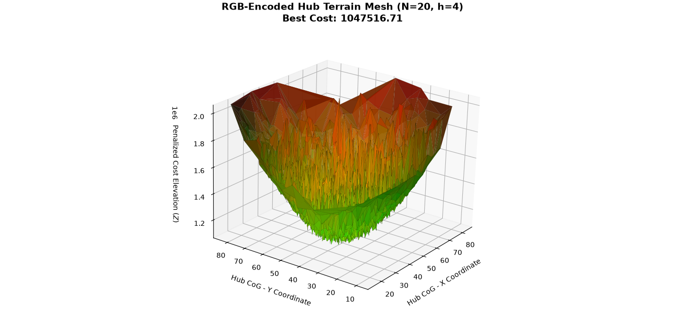
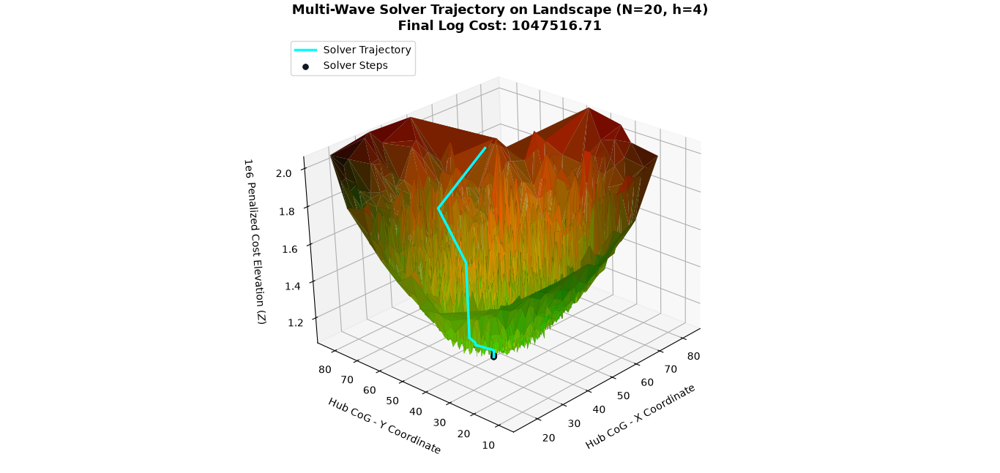
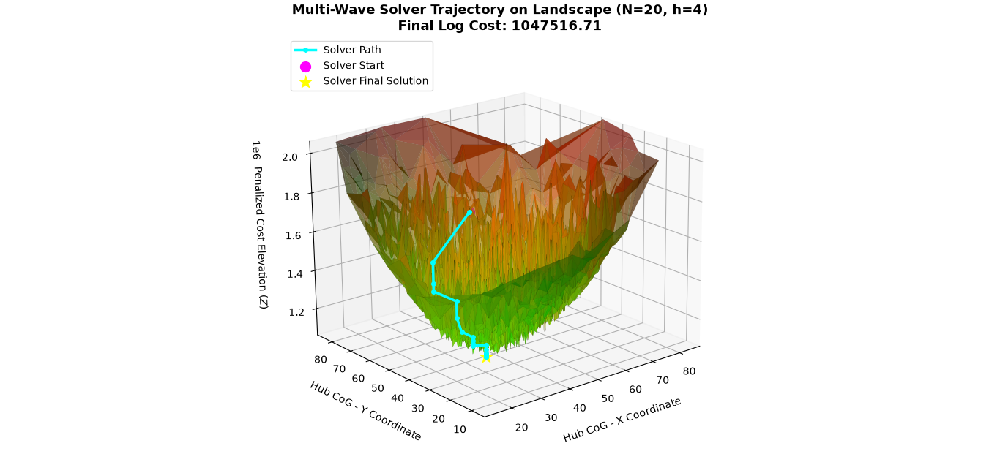
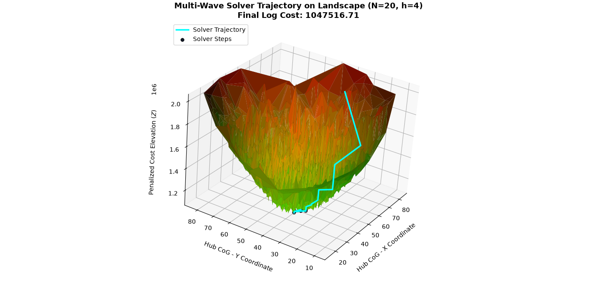

# depth map analysis for the 20 node proposition

Cost Landscape
| 

### Graph Overview
- This depth map visualizes solution quality across different hub configurations relative to the map's center. The **position** on the plot represents the Center of Gravity (CoG) of the hubs, while the **color gradient** channels indicate performance—ranging from **green** (low-cost solutions are green) and **red** (the hubs are more dispersed from the CoG).

**Examples**: 
- Pure green solutions means the cost is favorable with hubs clustered closer to the CoG.

- Yellow solutions are also favorable but with the hubs more dispersed from the CoG.

- Red solutions are the sub-optimal solutions that have a higher relative cost with hubs dispersed.
---

**We deduce that:**
- **Good solutions have low hub dispersion:** The basin of good solutions is almost pure green.
- **Good solution's CoG lies near the center of the map:** The green basin is not skewed.
- **Hub dispersion has a relation with the solution quality:** The smooth transition from green to yellow to red shows that more dispersed hubs lead to worse solutions.
- **Distance from the center degrades solution quality:** The basin shape indicates that the further the Center of Gravity (CoG) is from the center, the worse the solution becomes.

---

this depth map is aimed to simulate an optimization visualzation that is called **the optimization landscape** 

---
# Optimization trajectories

(a) Optimization path 1 | (c) Optimization path 2 | (d) Optimization path 3 |
| :---: | :---: | :---: |
|  |  |  |

**key takeways:**
- Diffirent initial seeds head to the same optimum 
- The algorithm converges to the optimum quickly